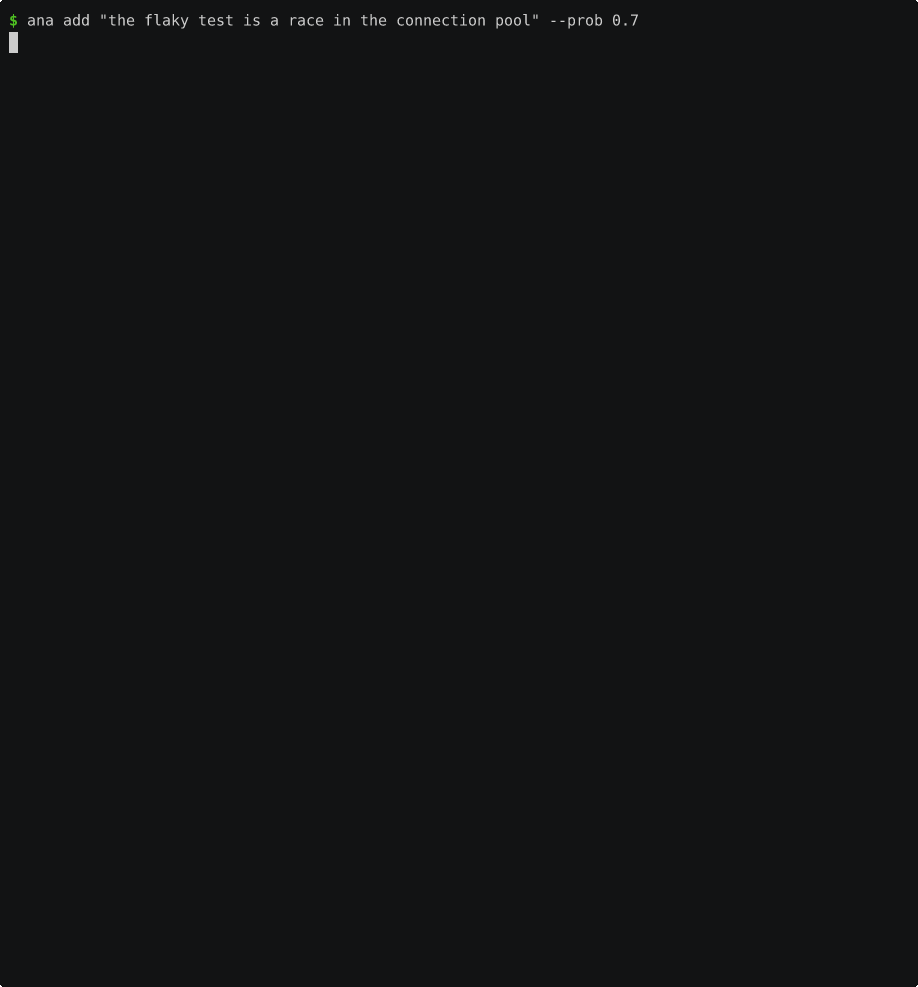

# Anamnesis

A local command-line tool, written in Rust and MIT-licensed, that records how sure you
are before you find out, then checks whether your "80% sure" comes true 80% of the time.
It works the same for a person and for a coding agent.

[](https://github.com/Anbu-00001/Anamnesis/actions/workflows/ci.yml)
[](https://github.com/Anbu-00001/Anamnesis/releases)
[](LICENSE)

```bash
ana add "the flaky test is a race in the connection pool" --prob 0.7 --by 2027-01-15
ana resolve <id> yes
ana report
```

## Why

You remember being less surprised than you were. A prediction written down before the
outcome is the one version of your belief that hindsight cannot edit, so Anamnesis keeps
that one and scores it. Forecasts are appended, never overwritten, and the score always
grades the **first** forecast on a claim: revising a number once the evidence is in
cannot improve your record. Scoring is plain arithmetic on one local JSON file, with no
model and no network.

## Install

```bash
# from source (Rust 1.89 or newer)
cargo install --git https://github.com/Anbu-00001/Anamnesis --locked

# or a prebuilt binary for Linux, macOS, or Windows under Git Bash
bash <(curl -fsSL https://raw.githubusercontent.com/Anbu-00001/Anamnesis/main/plugin/install-ana.sh)
export PATH="$HOME/.anamnesis/bin:$PATH"
```

The installer stops unless the binary matches the release checksum. With the GitHub CLI
signed in, it also stops unless the binary's build attestation verifies. To check a
download yourself (releases from 0.6.0 on carry one):

```bash
gh release download v0.6.0 -R Anbu-00001/Anamnesis -p ana-x86_64-unknown-linux-gnu
gh attestation verify ana-x86_64-unknown-linux-gnu -R Anbu-00001/Anamnesis
```

## A first look

`ana demo` builds a fictional year of predictions in a temporary directory, reports on
it, and touches nothing of yours. The top of what it prints:

<!-- BEGIN:report_head -->
```

ANAMNESIS — the shape of your judgement
=========================================

44 of 50 resolved (35 yes/no · 9 numeric)  ·  6 open  ·  first recorded 2025-01-19  ·  latest 2025-06-24

  Resolution discipline   88% graded (44 of 50)  ·  2 overdue
    ⚠ 2 claim(s) past due and ungraded — resolve them; until you do, the numbers below rest on a self-selected sample.
    Your ungraded calls are more CAUTIOUS than your graded ones (boldness 0.62 vs 0.76, ASMD 0.79) — your graded sample leans bold relative to what you actually predicted.

  VERDICT          NO MISCALIBRATION FOUND
                   At your 35 calls, this test catches a forecaster 30% too extreme only 0% of the time, so this silence says little.

  Brier score      0.272   (0 = perfect · 0.25 = always 50/50 · lower better)
                   scored on your FIRST forecast — the belief you recorded before the answer was known
                   on your final forecast it would be 0.268 (shown, not graded)
                   95% bootstrap band [0.180, 0.365] — how far luck alone could move it
  Stake-weighted   0.277   vs 0.272 flat → about the same across stakes
  Log score        0.793   (lower better; punishes confident misses)
  Brier skill      -0.112   (you did WORSE than always guessing the base rate)
  Lately           0.244   recent Brier vs 0.272 lifetime → improving  (last ~5 weighted; directional, not significant)
  Base rate        0.429   (fraction of your claims that came true)   95% CI 0.28–0.59

  Decomposition  (Brier = Miscalibration − Discrimination + Uncertainty)
    miscalibration 0.065   calibration error      ↓ lower is better
                   1.16x the 0.056 that only 1 calibrated forecaster in 20 exceeds on these same calls
    discrimination 0.037   sorting power          ↑ higher is better
    uncertainty    0.245   irreducible difficulty of your questions
    check          0.065 − 0.037 + 0.245 = 0.272  (= Brier, exactly — no bins, no tuning)
```
<!-- END:report_head -->

> [!NOTE]
> "No miscalibration found" next to a negative Brier skill is not a contradiction. The
> calibration error (0.065) is larger than the sorting power (0.037), which makes the
> skill negative, but it is only 1.16 times what luck alone produces on these calls, so
> the report will not call it real. The line under the verdict says how weak the test is
> at this size: not found is not absent.

The rest of the report covers discrimination, the sequential evidence test, a
reliability diagram and a per-group breakdown. `ana report --plain` says the same in
plain English, and `--html` and `--badge` render a card and an SVG badge. Below 20 graded
calls there is no verdict; the report lists the calls graded so far instead.



## Commands

| | |
|---|---|
| `ana add "<claim>" --prob 0.7 --by <date>` | log a prediction; `--interval LO HI` for a number |
| `ana update <id> --prob 0.6` | revise it (shown, never graded) |
| `ana resolve <id> yes` | record what happened |
| `ana report` | the calibration report; `--plain`, `--json`, `--html`, `--badge` |
| `ana decide --prob 0.7 --stake 5` | proceed, verify or abstain, corrected by your record |
| `ana add ... --check "cargo test"` then `ana run <id> -- cargo test` | a prediction graded by the command's own exit status |
| `ana import history.csv` | bring an existing history (`statement, prob, created, resolve_by, outcome, resolved_at, tags`) |
| `ana void`, `ana amend`, `ana list`, `ana show`, `ana where` | annul, fix a typo, browse, find your files |

## With Claude Code, or any MCP client

Inside Claude Code:

```
/plugin marketplace add Anbu-00001/Anamnesis
/plugin install anamnesis
```

The plugin's hooks give the agent its standing calibration at the start of each session,
and on a random one prompt in seven. They grade `kind:tests-pass` predictions from a test
run's real exit status, so that part of the record does not rest on the agent's word.
Type `?70` as a whole prompt to bet 70% that the agent's next test run after an edit
passes. The agent never sees the bet, and it is graded the same way. `ana mcp` serves
`predict`, `update`, `resolve`, `calibration`, `recalibrate`, `decide`, `void`, `amend`
and `list` to any MCP client. Details: [docs/AGENTS.md](docs/AGENTS.md) and
[plugin/README.md](plugin/README.md).

## What it touches

- **Your ledger:** `~/.anamnesis.json`, or the file given by `--data` or `ANAMNESIS_DATA`.
- **The agent's ledger and logs:** `~/.anamnesis/`. This holds `agent.json`, the hooks'
  logs (`protocol.jsonl`, `outcomes.jsonl`, `checkpoints.jsonl`; never a prompt, a command,
  a file name or any output), your bets (`bets.json`) and the prebuilt binary (`bin/`).
  `ana where` prints every path.
- **Network:** none. The installer downloads from GitHub releases, and that is all.
- **What a model sees:** the hooks' short context lines. Any claim text in them goes out
  as one bounded line, labelled as stored data. Nothing is said in a trial's OFF week.
- **Removing it:** remove the plugin in Claude Code's `/plugin` menu, then run
  `cargo uninstall anamnesis` or delete `~/.anamnesis/bin`. Your ledgers stay until you
  delete them.

Threat model and reporting: [SECURITY.md](SECURITY.md). The tool guards against
hindsight, not against you editing your own JSON.

## What it will not tell you

- **That you are calibrated.** A quiet evidence test is reported as a quiet test, together
  with how often it would have caught an error of 30%. It is weak against a gentle drift
  toward 50/50.
- **Anything before 20 graded calls, or once more than one in ten settled calls were
  voided or reworded.** A claim joins the test once it is due, 7 days after logging unless
  `--by` says otherwise.
- **That a check was a good one.** An exit status grades a claim but does not choose the
  command. `--check true` is refused, but a suite too narrow to fail still passes.
- **That using it makes anyone better.** That is not yet measured. Two experiments are
  set up to measure it, with their rules fixed before any data:
  [docs/MEASUREMENT.md](docs/MEASUREMENT.md).

## How it compares

Fatebook and Metaculus are better if you want to forecast with other people, on the web
or on a phone, and Fatebook is open source. PredictionBook went read-only in 2024.
Calibration quizzes are a quick check on trivia, and a decision journal keeps your
reasoning without scoring it. Anamnesis is a private record of the calls you make in your
own work, including your coding agent's, graded on the number you wrote down before you
knew. It is a CLI with one maintainer.

| | Anamnesis | Fatebook | Metaculus | calibration quizzes |
|---|---|---|---|---|
| where the data lives | local JSON file | hosted service | hosted platform | nowhere |
| interface | CLI, MCP, editor hooks | web, API, Slack, extension | web, API | web page |
| questions | yours | yours | the community's | pre-written trivia |
| scoring basis | first forecast | latest forecast | time-averaged | instant |
| sequential evidence test | yes, anytime-valid | no | no | no |
| acts on the number | `ana decide` | no | no | no |
| forecasting with others | no | yes | yes | no |
| account required | no | yes | yes | no |

## Methods and citation

The Brier score is split into miscalibration, discrimination and uncertainty with the
CORP decomposition, reported against its own noise floor (Dimitriadis, Gneiting and
Jordan, PNAS 2021). Whether a miscalibration is real is answered by an anytime-valid
e-process, which stays valid however often you look (Arnold, Henzi and Ziegel, Annals of
Applied Statistics 2023). `ana decide` applies Chow's reject rule to the recalibrated
probability. Every number, and the measurement behind it, is in
[docs/METHODS.md](docs/METHODS.md); the scoring core is also a Python library
([docs/PYTHON.md](docs/PYTHON.md)). GitHub's "Cite this repository" link reads
[CITATION.cff](CITATION.cff).

## How this was built

I built this with Claude Code. Claude wrote most of the code and most of these docs. My
part was deciding what it should do and pushing back when Claude got it wrong. Claude was
also the first user: it logged its own predictions while it worked and resolved them as
the answers came in. Two outside reviews ran the binary the way a skeptical user would.
They found defects the test suite had not caught, in what the numbers meant rather than
in the arithmetic. The [CHANGELOG](CHANGELOG.md) has each one, with the numbers from
before, and `validation/repro.sh` replays them against the current build.

## Documentation

| | |
|---|---|
| [docs/METHODS.md](docs/METHODS.md) | every number, why it is that number, and the measurement behind it |
| [docs/MEASUREMENT.md](docs/MEASUREMENT.md) | the experiments on whether the tool helps, with their rules fixed in advance |
| [docs/AGENTS.md](docs/AGENTS.md) | the MCP server, the Claude Code plugin, grading by exit status |
| [docs/DATA_FORMAT.md](docs/DATA_FORMAT.md) | the ledger format and the threat model |
| [docs/DESIGN.md](docs/DESIGN.md) | why it is shaped this way |
| [docs/PYTHON.md](docs/PYTHON.md) | the scoring core as a Python library |
| [CONTRIBUTING.md](CONTRIBUTING.md) | build, test, what CI checks, and how to reproduce every measurement |
| [CHANGELOG.md](CHANGELOG.md) | what changed, and what it changed from |

## Contributing, security, license

Issues and pull requests are welcome; [CONTRIBUTING.md](CONTRIBUTING.md) says how to build
and test, and what CI checks. Report a vulnerability as [SECURITY.md](SECURITY.md)
describes, not in a public issue. MIT, see [LICENSE](LICENSE).
